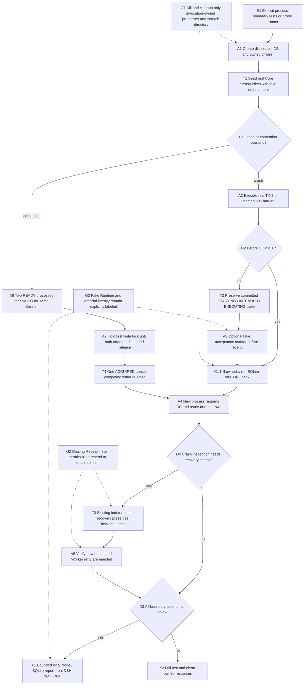
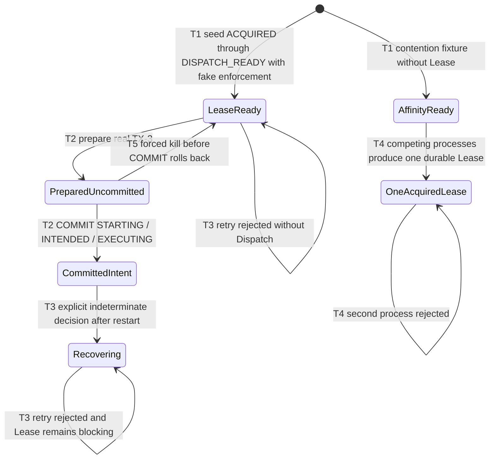

# Owned process crash and SQLite Lease contention verification

Explicit tests or the local probe runner create a disposable SQLite database and
launch only their own Node child processes. The real Core `acquireExecutionLease`
and `prepareGovernedDispatch` write the fixture ledger. Capability enforcement and
external acceptance are explicitly fake prerequisites; this flow does not prove a
real DeepSeek Harness dispatch, Provider run, model, cleanup or production host
restart.

Three named crash barriers cover TX-3 before COMMIT, after COMMIT but before a
Runtime call, and fake external acceptance before Receipt persistence. The parent
receives the barrier via IPC, forcibly kills that exact child, and launches a new
process to reopen the same isolated DB. Before COMMIT, the complete uncommitted
TX-3 tuple rolls back: no Execution or Dispatch survives and Lease remains
DISPATCH_READY. After COMMIT, STARTING Execution, INTENDED Dispatch and EXECUTING
Lease survive together. Neither post-COMMIT scenario has a durable Receipt or
Runtime reference, even though one scenario has an independent fake acceptance
marker. This deliberately demonstrates that missing receipt/event evidence
cannot establish non-dispatch.

The new process calls the existing reconcile entry, then explicitly applies the
Core indeterminate-evidence recovery decision. Committed uncertain tuples become three RECOVERING
rows. It also attempts a new same-Session Lease and calls the real Worker runner:
the Lease constraint rejects the former and the active-Lease guard rejects the
latter before any Runtime action. Recovery does not complete the Task or release
its Lease. For the pre-COMMIT scenario there is no Dispatch to reconcile; the
retained DISPATCH_READY Lease continues to block blind retry.

For contention, two genuinely different processes open the same initialized
database with `openExistingOnly`. Both report READY, then receive GO. The first
BEGIN IMMEDIATE writer holds a test-only file barrier until the parent has
observed both acquire attempts. After a bounded artificial hold, the writer
commits and the other process either reaches the Session unique constraint or
reports SQLITE_BUSY. Exactly one Lease survives. This probe stops at acquisition;
neither participant invokes Runtime dispatch. Reported lock acquisition and total
elapsed times include the artificial barrier and cannot measure production
latency or establish multi-host behavior.



```mermaid
sequenceDiagram
  actor V as Test or probe caller
  participant P as Parent process
  participant C as Owned writer child
  participant S as SQLite temporary DB
  participant F as Fake external marker
  participant R as New inspection child
  V->>P: Invoke named crash or contention scenario
  P->>C: Initialize isolated Core fixture
  alt Crash barrier
    C->>S: BEGIN IMMEDIATE; prepareGovernedDispatch
    alt Before COMMIT
      C-->>P: IPC barrier with uncommitted tuple
      P->>C: SIGKILL exact owned ChildProcess
      S->>S: Roll back uncommitted TX-3
    else After COMMIT
      C->>S: COMMIT Execution / Dispatch / Lease
      opt Fake accepted before Receipt
        C->>F: Write and flush FAKE_RUNTIME_ACCEPTANCE
      end
      C-->>P: IPC barrier before receipt persistence
      P->>C: SIGKILL exact owned ChildProcess
    end
    P->>R: Launch genuinely new process on same test DB
    R->>S: Read durable tuple and explicitly apply indeterminate recovery
    R->>S: Attempt same-Session Lease; verify rejection
    R->>R: Worker guard rejects before Runtime action
    R-->>P: Bounded rows and rejection categories
  else Two-process contention
    P->>C: Launch two connections; wait for both READY
    P->>C: GO to both processes
    C->>S: Two actual BEGIN IMMEDIATE acquire attempts
    C-->>P: Both ATTEMPTING and first LOCK_HELD
    P->>C: Release test barrier after bounded artificial hold
    S-->>C: One commit; one uniqueness or busy rejection
    C-->>P: Lease results and local elapsed observations
    P->>R: Reopen and confirm exactly one Lease, no Dispatch
  end
  P-->>V: Local fake-Runtime report or assertion failure
  P->>P: Stop only owned children and remove owned scratch
```



Validation: `node --test tests/governed-process-boundaries.test.ts`, using the
current emitted library or an isolated verification stage. The optional
`KINGDOM_PROCESS_PROBE_LIB_ROOT` selects that stage; optional
`KINGDOM_PROCESS_PROBE_REPORT` writes a private JSON result from the same test
execution. Public reports contain no temporary database paths, credentials,
conversation content or file hashes. Process timing is recorded dynamically.
