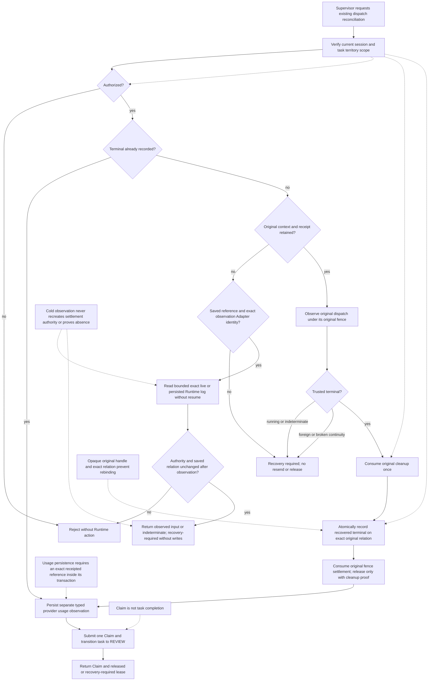
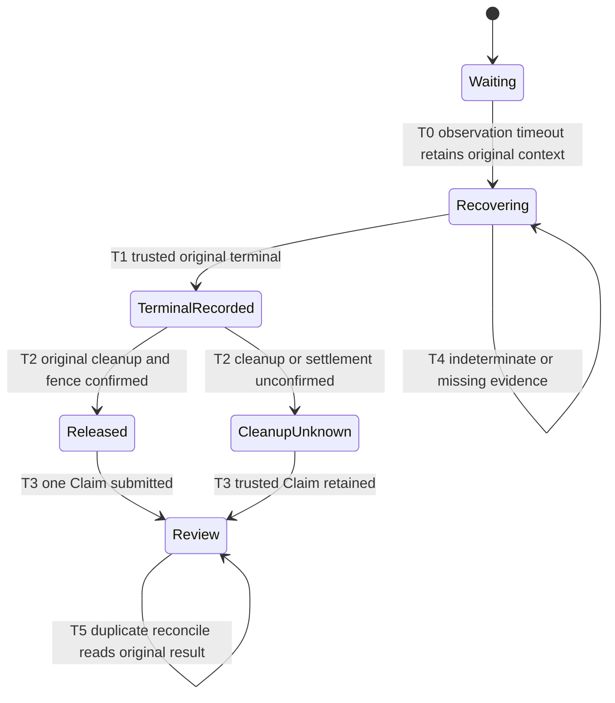

# Governed reconcile

An authenticated, currently scoped Supervisor explicitly reconciles an existing dispatch through the tool or local GUI. Reconciliation never dispatches another prompt. The original process may retain the exact RunnerContext, Runtime fence and one-shot cleanup callback after an observation timeout. Only that original receipted context may consume late terminal evidence. When receipt or original context is missing, a fresh trusted Adapter may read the exact pre-committed Runtime reference through live or public read-only persistence APIs. This cold branch reports a bounded observation and remains recovery-required, even if it sees a terminal-looking Runtime event. It creates no receipt, RunnerContext, fence, usage event, Claim or release. Absence of the input does not prove non-dispatch. No restart cleanup is inferred from an empty disposer registry.



```mermaid
sequenceDiagram
  actor S as Supervisor
  participant P as Public tool or GUI
  participant R as Retained reconciliation context
  participant D as DSH Runtime
  participant O as Fresh observation Adapter
  participant C as Core ledger
  S->>P: Reconcile dispatch
  P->>C: Resolve current Supervisor and territory
  alt Original receipt and process context retained
  P->>R: Consume original process context
  R->>D: Read current events and original fence
  D-->>R: Terminal or indeterminate
  alt Trusted terminal and unchanged authority
    R->>D: Original one-shot cleanup
    R->>C: Recovery terminal transaction with original port
    R->>D: Original fence settlement and release
    R->>C: Lease release or recovery-required
    P->>C: Idempotent Claim and REVIEW transaction
  else Context missing, foreign activity or indeterminate
    R-->>P: Recovery required without resend
  end
  else Original receipt or process context unavailable
    P->>O: Exact saved Runtime reference and current authorization
    O->>D: Bounded live snapshot or open read-only, read and close
    D-->>O: Exact input found or indeterminate
    O-->>P: Bounded observation, no raw events or Session content
    P->>C: Re-read exact saved relation and authority
    P-->>S: Recovery required; no usage, receipt, cleanup, Claim or release
  end
  P-->>S: Current result and remaining limitation
```



The recovery-specific methods do not enable normal RunnerContext recreation. They accept the same opaque handle/version held at timeout. Unrelated ledger revisions may advance while waiting; any change to the exact task, execution, lease or dispatch tuple invalidates recovery. The GUI cannot supply Runtime evidence, a Session, a role or a cleanup receipt.

Validation covers late-terminal completion, duplicate requests, authorization loss, cross-territory access, lost process context, foreign activity, unconfirmed cleanup, atomic rollback and failure after Runtime fence release. Public Tool and loopback HTTP tests exercise the registered routes; WAIT and missing dispatch return `ok=false / RECOVERY_REQUIRED` in the GUI. Provider/runtime usage is persisted separately as typed runtime-observation events and never used as terminal or cleanup proof. Usage observations also occur after unsuccessful starts and WAIT results when the same receipt is observable; missing usage is never interpreted as zero cost.

The cold branch has no persisted state transition. DSH prepared references are registered before enqueue, so a nonempty reference is not an acceptance receipt. The Adapter reads at most 10000 events and bounds each persistence operation; truncated or unreadable logs are indeterminate. Only exact input IDs establish positive observation. Public results skip provider-usage collection on this read-only branch. The matching-version keyless product probe exercises actual Adapter prepare, Core COMMIT, DSH enqueue/flush, forced writer termination and a fresh Adapter read; fixture enforcement prerequisites do not constitute full governed Provider execution.
